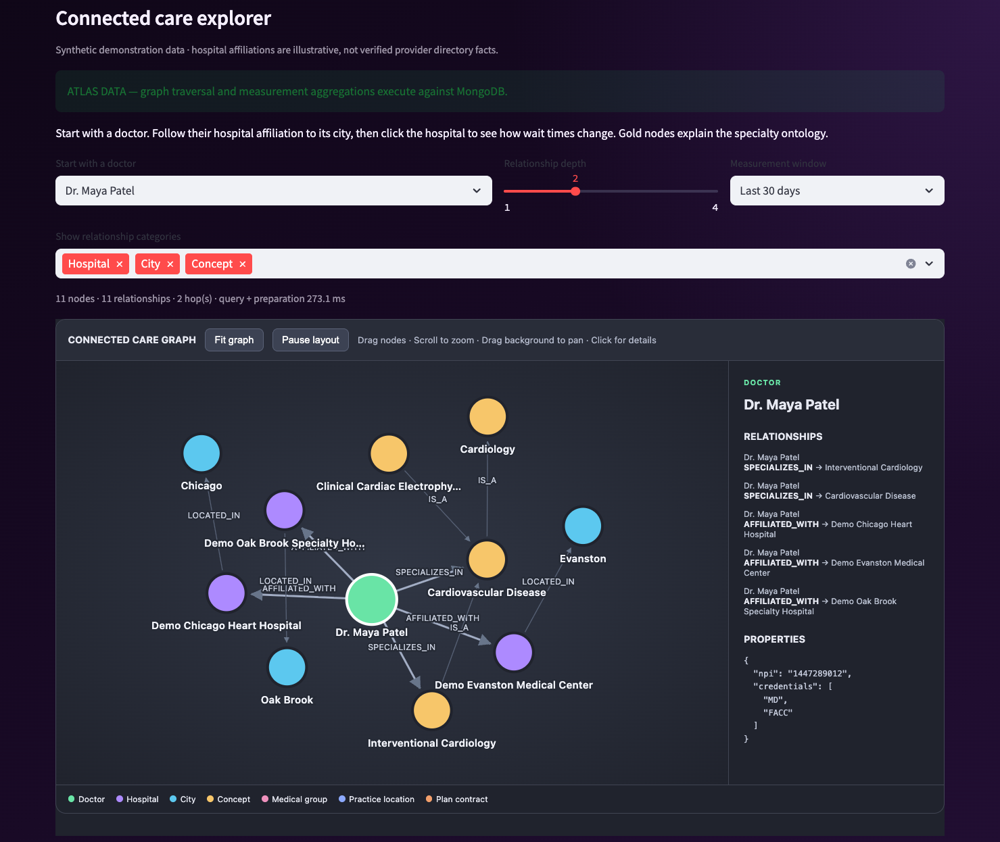

# CommandCare

### Find the right provider. Understand the connections. See what is changing.

**An interactive healthcare demo combining provider documents, semantic search, ontology traversal, and hospital time series in MongoDB Atlas.**

A doctor is more than a directory entry. They practice at different locations, belong to medical groups, participate in location-specific plan contracts, and specialize in concepts that patients describe in everyday language. The hospitals around them also change over time: wait times rise, occupancy shifts, and patient arrivals fluctuate.

CommandCare puts those perspectives in one application. Explore the relationships, inspect the underlying evidence, and move from **who and where** to **meaning and operational context**.



## Why this demo exists

Provider applications often spread operational records, search, and measurements across different systems. That creates more data movement and more work to connect a search result to the facts behind it.

CommandCare demonstrates a consolidation pattern: regular MongoDB documents hold provider and relationship data, MongoDB Vector Search discovers relevant concepts and passages, and native time series collections hold hospital measurements. Shared identifiers connect the experiences.

**One application. One data platform. Several ways to understand the same care ecosystem.**

## What you can explore

| Experience | What it shows |
| --- | --- |
| **Connected Care Graph** | A doctor-centered graph with labeled hospital, city, specialty, medical group, practice location, and plan contract relationships. |
| **Patient Search** | Natural-language vector matches, similarity scores, the matched ontology path, filtered provider locations, and illustrative patient cost estimates. |
| **Provider Structure** | Nested provider documents with multiple tax entities, locations, and plan contracts. |
| **Location Explorer** | Location-specific attributes such as languages, hours, accepting-new-patient status, and plan participation. |
| **Architecture Copilot** | Semantic retrieval over seeded domain passages, followed by upstream dependency and downstream impact traversal. |
| **Pipelines** | The MongoDB operations behind the demo, exposed for technical walkthroughs. |
| **Seeded Data** | The sample documents and structures that power the experience. |

### A graph you can actually explore

Start with **Dr. Maya Patel**, then follow the labeled relationships:

| Starting point | Relationship | Connected entity |
| --- | --- | --- |
| Doctor | `AFFILIATED_WITH` | Hospital |
| Hospital | `LOCATED_IN` | City |
| Doctor | `SPECIALIZES_IN` | Specialty concept |
| Specialty concept | `IS_A` | Broader concept |
| Doctor | `MEMBER_OF` | Medical group |
| Doctor | `PRACTICES_AT` | Practice location |
| Medical group | `OPERATES` | Practice location |
| Doctor | `HAS_CONTRACT` | Plan contract |
| Plan contract | `APPLIES_AT` | Practice location |

Drag nodes, pan, zoom, pause the layout, and click a node to inspect its properties and visible relationships. Adjust traversal depth from one to four hops and choose which entity categories appear.

Click a **hospital** to see its emergency department wait-time trend in the graph detail panel. The facility selector below the graph independently controls the larger occupancy and wait-time charts.

### Make the ontology visible

The graph connects actual demo entities. The ontology explains the specialty categories they connect to.

For example, **Interventional Cardiology** connects through `IS_A` relationships to **Cardiovascular Disease** and then **Cardiology**. Patient Search maps everyday language to a concept, then traverses its hierarchy to explain the classification and resolve provider matches.

That gives a presenter two useful questions to answer: **“Why did this doctor match?”** and **“Where can this doctor deliver care?”**

### Put measurements beside the relationships

The seed creates **three synthetic hospitals** and **2,160 hourly observations** covering 30 days. Each measurement contains:

- Hospital identity in stable metadata.
- A timestamp.
- Bed occupancy percentage.
- Emergency department wait time.
- Patient arrivals during the interval.

Choose a 7-, 14-, or 30-day window. MongoDB aggregates the observations into daily occupancy and wait-time averages and arrival totals. Calendar-day grouping uses `America/Chicago`; the first and last days of a window may be partial.

## Quick start

### 1. Add the files

Place `app5.py`, this `README.md`, and `CommandCare.png` at the repository root. The screenshot above uses that exact image filename, including capitalization.

### 2. Install the dependencies

Use Python 3.10 or later in a virtual environment:

```bash
python3 -m venv .venv
source .venv/bin/activate
python -m pip install --upgrade pip
python -m pip install streamlit pandas "pymongo[srv]"
```

On Windows, activate the environment with `.venv\Scripts\activate` instead.

### 3. Launch CommandCare

```bash
streamlit run app5.py
```

You can explore the locally generated **preview** before connecting to Atlas. Preview mode does not execute database queries or demonstrate live vector search.

### 4. Connect to Atlas

Paste your connection string into the **masked sidebar field** and click **Connect**. No source-code changes, `.env` file, or separate embedding API key are required by this app.

For the full experience, use an Atlas deployment with Automated Embedding available, allow the machine running Streamlit to reach the cluster, and use a database identity with permissions to read and write the demo data, create collections and indexes, and manage its search indexes.

This version configures Automated Embedding with **`voyage-4`**. Check the [Automated Embedding documentation](https://www.mongodb.com/docs/vector-search/crud-embeddings/automated-embedding/) for current availability and requirements. Automated Embedding is documented as a preview feature; dedicated clusters also require storage auto-scaling.

### 5. Seed the experience

Click **[S] SEED V4 + GRAPH + TIME SERIES** in the sidebar. The V4 label is intentional: `app5.py` reuses the database and index names introduced in that version.

The app populates the demonstration collections, creates supporting indexes, and requests two automated embedding indexes. Index building and embedding happen asynchronously. Click **[I] REFRESH INDEX STATUS** and wait for the indexes to be ready before running semantic searches.

> Seeding replaces the existing sample documents and refreshes the synthetic measurement history. Use the dedicated demo database, `healthcare_ontology_demo_v4`, for this application.

## A five-minute walkthrough

1. **Start with the graph.** Select Dr. Maya Patel in **Connected Care Graph**. Show her hospital affiliations and follow each hospital to its city.
2. **Explain the meaning.** Click a gold specialty node. Increase the relationship depth to reveal broader categories and describe how `IS_A` makes the classification explicit.
3. **Add operational context.** Click a hospital for its wait-time trend. Use the detailed facility charts below to compare occupancy and wait time across different windows.
4. **Show semantic discovery.** Open **Patient Search** and enter: “I need a doctor who performs heart catheterization.” Show the vector matches and scores, ontology path, and provider locations. For a clear first run, use Chicago, Spanish, and Choice Plus PPO.
5. **Show the document model.** Open **Provider Structure** or **Location Explorer** to inspect multiple tax entities, practice locations, and the contracts that apply at those locations.
6. **Open the hood.** Use **Pipelines** to explain the database operations. For a second retrieval scenario, show **Architecture Copilot** and its dependency evidence.

**Presenter note:** Patient Search and Connected Care Graph are separate entry points in this version. The graph starts from the doctor dropdown; vector search results do not automatically select or open a graph node.

## How it works

| Capability | Implementation in this demo |
| --- | --- |
| Operational provider data | Nested documents preserve provider, tax entity, location, and plan contract context. |
| Semantic discovery | `$vectorSearch` queries the `searchText` field using Automated Embedding and returns similarity scores. |
| Specialty ontology | `$graphLookup` traverses parent/child concept relationships. |
| Connected care graph | `$graphLookup` traverses the `provider_graph` collection; an embedded SVG view renders the nodes and labeled edges. |
| Hospital history | Native time series storage with `timestamp` as the time field and `metadata` as the metadata field. |
| Trend analysis | Aggregation pipelines filter a time window and group measurements into local calendar days. |
| Architecture context | Vector retrieval finds domain passages; graph traversal resolves connected architecture dependencies. |

Atlas handles document and query embedding for the configured indexes. The app does not call an LLM to generate its answers; the Architecture Copilot assembles retrieved evidence and dependency context that could be supplied to an agent or LLM.

### Collections

All collections live in **`healthcare_ontology_demo_v4`**.

| Collection | Purpose |
| --- | --- |
| `providers` | Provider profiles, tax entities, nested practice locations, and plan contracts. |
| `concepts` | Specialty concepts, definitions, synonyms, and parent relationships. |
| `healthcare` | Searchable healthcare descriptions linked to concept IDs. |
| `provider_graph` | Graph projection with entity properties, labeled outgoing links, and neighbor IDs. |
| `hospitals` | Synthetic hospital identities and facility attributes. |
| `hospital_metrics` | Native time series collection containing hourly hospital observations. |
| `domain_documents` | Seeded narrative passages linked to architecture nodes. |
| `architecture_nodes` | System nodes and dependency relationships. |

The graph's neighbor list supports traversal in either direction. Edge arrows retain the meaning of each labeled relationship. Category filters control the visible graph after traversal.

### Two vector indexes

| Index | Collection | Indexed field | Model |
| --- | --- | --- | --- |
| `healthcare_autoembed_v4` | `healthcare` | `searchText` | `voyage-4` |
| `architecture_autoembed_v4` | `domain_documents` | `searchText` | `voyage-4` |

Searchable text lives in regular collections. Hospital measurements live in the time series collection. Native time series collections do not support MongoDB Search or change streams; an application needing searchable narratives or change-driven current-state updates should keep those documents in regular collections. See [time series limitations](https://www.mongodb.com/docs/manual/core/timeseries/timeseries-limitations/).

## Connection handling

The connection string is entered through a password-style field and cleared on submission. The MongoDB client is retained in the individual Streamlit session, and the app does not write the URI to its source or configuration files. **Disconnect** closes the client and clears retrieved results. Credentials must still be handled securely by the machine hosting the app; a masked field is not a credential vault.

## Troubleshooting

| Symptom | What to check |
| --- | --- |
| Cannot connect | URI format, database credentials, cluster network access, and connectivity from the Streamlit host. |
| Graph is still in preview mode | Connect successfully and complete the seed step. The live view displays an **ATLAS DATA** banner. |
| Semantic search is not ready | Wait for both embedding indexes to finish building, then refresh index status. |
| Index creation fails | Verify database permissions, Automated Embedding availability, model support, and cluster requirements. |
| A node seems to be missing | Increase relationship depth or include its entity category in the graph filters. |
| Hospital has no recent measurements | Reseed to regenerate the rolling synthetic history. |
| Graph click does not change the larger charts | The graph detail panel and the detailed facility selector are intentionally independent. |

## Demo boundaries

All seeded people, facilities, affiliations, contracts, costs, and measurements are synthetic. Hospital affiliations are illustrative, and cost estimates are simplified demonstration calculations. The graph projection refreshes during seeding; continuous source synchronization, live hospital feeds, and arbitrary document upload are not implemented.

CommandCare demonstrates an application architecture and a consolidation opportunity. Validating a replacement for existing operational, search, or time series systems requires their actual query patterns, throughput, retention, and availability requirements.

---

**Explore the provider. Follow the relationships. Understand the context.**
